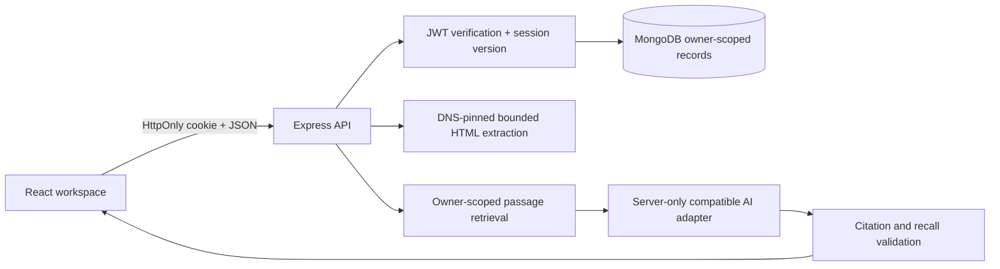

# Architecture and audited foundation

The audit found a strict TypeScript Express API, Mongoose/MongoDB, seven original routes, a hardcoded JWT secret, seven-day bearer JWTs, plaintext passwords, string-array tags, and `User → Content` and `User → Links` relationships. The React 19/Vite frontend consisted of two buttons. The README was empty. Original build/lint commands could not run because dependency installations lacked platform executables; starter Button/icon types also contained errors. No AI, collections, recall, tests, frontend authentication or search existed.

## Request/data flow

`index.ts` owns connection/startup/shutdown. Importing models does not connect to a database. `app.ts` preserves and extends the API. `security.ts`, `middleware.ts`, `metadata.ts` and `ai.ts` own the security, authentication, extraction and provider/retrieval boundaries. The provider interface is replaceable without changing page components or persistence models.

The frontend API client centralizes credentials, errors, request cancellation and session expiration. Feature hooks own query contracts. Query invalidation refreshes persisted content, collection memberships, study cards and sharing status. The UI uses pessimistic mutations to avoid incorrect optimistic state. Lazy page chunks keep React Flow out of the initial route bundle. Native `<dialog>` provides focus trapping, Escape dismissal and a modal accessibility boundary; focus is restored on unmount. Reduced motion is respected.

## Private data and authentication

Every private API route uses JWT authentication plus a database session-version check. Every model query/update includes the authenticated owner, or selects a user by the authenticated ID. Login responses retain `{ token }` for existing clients, while browsers use an HttpOnly, SameSite=Lax cookie. The browser never stores bearer tokens in localStorage. Production cookies use Secure, requiring HTTPS and a same-site deployment. Logout increments the user session version, revoking all sessions, including bearer tokens. Existing tokens without a version are accepted only while the user version is zero.

Passwords use Node scrypt with random 16-byte salts and timing-safe comparison. New passwords have a minimum length of eight. Legacy passwords are timing-safely verified and upgraded only after successful login. The old local signing secret is retained for local compatibility; production refuses to start without an explicit long secret. Rotating it intentionally invalidates existing tokens.

CORS allows exact configured origins, credentialed responses and JSON-only writes. SameSite cookies, JSON-only mutation requests and origin checks protect browser writes. JSON size is capped at 160 KB and compressed request bodies are disabled. Limits: 300 general requests/minute/IP, 20 auth attempts/15 minutes/IP, 20 AI operations/hour/account, and 15 imports/minute/account. Limits are in-process and require a shared store when scaled. No credentials or imported text are logged on request errors.

## Extraction and rendering

Only HTTP(S), no URL credentials, and standard ports. Every redirect (maximum three) resolves and validates all DNS addresses; non-public ranges and IPv4-mapped private IPv6 are rejected. The validated address is pinned into the HTTP socket lookup so DNS rebinding cannot switch targets. Each hop has an eight-second total deadline, no shared agent, no compression, a one-MB byte cap and HTML content-type checks. Cheerio strips active/navigation elements and extracts article/main text. Imported markup is never executed or injected into the frontend. Notes use react-markdown with GFM, raw HTML skipped, safe HTTP(S) links and no remote image loading. No server image proxy or third-party embeds are used.

Public sharing uses a strict serialization allowlist: content ID/title/link/type/description/text/tags/createdAt and the owner's username. It excludes ownership IDs, private collection membership, summaries, favorites, normalized URLs, AI chats, quizzes, passwords and keys. A selected-mode link filters by explicit owned IDs. Old links without a mode retain original whole-brain behavior. New links use cryptographically random 32-character capabilities and rotate on update.

## Retrieval and AI

1. Load only the authenticated owner's newest 1,000 resources.
2. Use saved full text when present, otherwise saved descriptions; never fetch unknown document text during a question.
3. Split into 1,000-character chunks with 150-character overlap, up to 40 chunks/item and 500 total candidates.
4. Default: match non-stopword question tokens, with extra weight for titles and tags; no positive overlap means no evidence.
5. Optional embeddings: preselect up to 80 candidates by keyword ranking, embed passages/question through the adapter, cosine-rank and require similarity above 0.25. A bounded 1,500-entry cache uses owner/model/passage SHA-256 keys; deletion removes passages from retrieval even if a vector remains cached. This is bounded hybrid retrieval, not an exhaustive vector index.
6. Supply up to six exact passages as untrusted data, separately from system instructions. Recent conversation turns supply context only, never source authority.
7. Request structured answers with inline numbered citations. Reject out-of-range citations; if no valid cited answer is provided, return a clear insufficient-evidence message. Source IDs, URLs and passages come exclusively from retrieval, never the model.
8. Persist user/assistant turns only after a complete successful request. A disconnected client aborts provider generation and does not create a partial conversation. Concurrent answers for an account are rejected until the prior request finishes.

AI calls have a 40-second timeout, bounded source/token inputs, account usage limits and actionable unconfigured/provider/rate-limit errors. Grounding cannot mathematically guarantee that a model's interpretation is correct. Exact passages remain visible for review.

## User-owned provider settings

The original UI/layout is preserved; the existing Settings panel contains a collapsible AI configuration form. Gemini uses native generateContent; OpenRouter/Groq/OpenAI/custom/Ollama use compatible chat completions. Provider responses normalize into the original feature contracts. Settings, model discovery and test routes require authentication. A 40-second, bounded, DNS-pinned transport performs no automatic retries or redirects. Cloud URLs are fixed, custom URLs require approved public HTTPS hosts, and optional Ollama is explicitly restricted to server loopback.

Keys live in a bounded account/session-version-scoped memory vault. Only provider/model/endpoint/free-only preference fields are persisted in browser storage. Neither database schemas nor existing content records change. Key removal/expiry/logout retain a disabled personal selection rather than reactivating server credentials. A connection-test badge requires an actual successful JSON generation request; configured-without-test is shown separately. Upstream machine codes are normalized into sanitized app errors, preserving authenticated sessions when a provider key is rejected. Free-only OpenRouter requests check current zero input/output/request prices and never choose a paid fallback. Complete-message generation and the original cancellation behavior remain in place.

See [AI providers](docs/AI-PROVIDERS.md) for exact lifetime, server-default/restart behavior, pricing evidence, capabilities and deployment limits.

## Graph and recall

Edges exist iff resources share at least one case-insensitive exact tag or collection ID. No random, inferred or semantic edges are claimed. Labels and sidebar show the saved-data reason. Rendering uses at most 100 nodes/350 edges, with connection highlighting and user-draggable positions held in page-local state.

Recall generation uses at most five owned text sources, 7,000 characters each, and eight cards/request. Validation requires owned source ID, exact quote, answer contained in quote, four unique choices and one exact correct answer. Reviews persist deterministic due dates and intervals; quizzes score against stored answers on the server and reject duplicate/foreign card IDs. Deleting content deletes its dependent cards; quiz records retain historical scores. Quizzes are a self-study tool, not an anti-cheating examination system.

## Scaling boundaries

This repository is a functional single-instance application. Before a broad SaaS launch, add shared rate limits/generation locks, background ingestion, database pagination/search, durable vector indexing, observability, provider-cost budgets and account recovery. Production infrastructure and real provider credentials are operator responsibilities, not simulated integrations.
